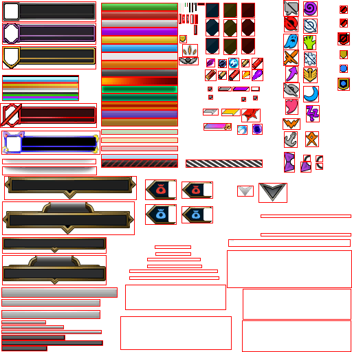

# DeeperHealthBarsLeague 🎮👁️

> Real-time Computer Vision & YOLOv8 Object Detection Pipeline for League of Legends Health Bars, Shields, and Game State Tracking.

---

## 📌 Overview

**DeeperHealthBarsLeague** is an end-to-end computer vision toolkit designed to detect, classify, and track in-game health bars and entities in League of Legends in real time.

Inspired by **[DeeperLeague](https://github.com/m-bain/deeperleague)** — which pioneered deep learning and computer vision analysis on the League of Legends minimap — this project brings real-time detection and game-state analysis directly to the **main gameplay camera**. By focusing on champion health bars, shields, structures, and minion waves, it enables fine-grained tracking of combat engagements, health trades, and map objectives.

Instead of manually annotating thousands of game screenshots, this project features a **fully automated synthetic dataset generator**:
- Slices official UI sprite sheets (frames, banners, health fills, shields, and resource bars).
- Composites dynamic health bars with realistic game states (normal health, grey health, shields, spell shields, Kled dismounted HP, mana/fury/energy) onto clean gameplay backgrounds.
- Augments scenes with perspective transforms, motion blur, and video compression artifacts.
- Trains YOLOv8 object detection models and provides a live screen-capture inference HUD.

---

## 🖼️ Pipeline Architecture & Sprite Slicing

Below is the reference map extracted from the game's UI atlas (`LolHealth-Bar/slice_preview_map.png`):

<p align="center">
  
  <br>
  <em>Auto-detected sprite atlas slicing used for synthetic health bar generation.</em>
</p>

---

## 🚀 Key Features

- **Synthetic Scene Generation**: Automatically generates hundreds or thousands of labeled YOLO training samples with ground-truth bounding boxes.
- **13 Detection Classes**:
  - `0`: Player Champion (Green)
  - `1`: Player + Yuumi attached
  - `2`: Ally Champion (Blue)
  - `3`: Ally + Yuumi attached
  - `4`: Enemy Champion (Red)
  - `5`: Enemy + Yuumi attached
  - `6`: Ally Turret
  - `7`: Enemy Turret
  - `8`: Ally Structure (Inhibitor / Nexus)
  - `9`: Enemy Structure
  - `10`: Jungle Monster (Big)
  - `11`: Epic Monster (Baron / Dragon / Herald)
  - `12`: Minion (Lane minions & small jungle creeps)
- **Pixel-Accurate Health & Shield Extraction**: Measures density and exact fill percentage along health bars, including regular shields, magic shields, and grey health.
- **Ultra-Fast Real-Time Inference**: Multi-threaded screen grabber (`mss`) + YOLOv8 + centroid tracking with live FPS and inference latency overlay. Compatible with Apple Silicon MPS, NVIDIA CUDA, and CPU.

---

## 📁 Repository Structure

```text
DeeperHealthBarsLeague/
├── requirements.txt                  # Python dependencies
├── .gitignore                        # Git ignore rules (excludes raw captures, .pt weights)
├── docs/                             # Documentation and visual assets
└── LolHealth-Bar/
    ├── Classified/                   # Hand-curated UI assets
    │   ├── Banners/                  # Champion level badge frames
    │   ├── Colors/                   # Health bar fill gradients (ally, enemy, player, shield)
    │   └── Frames/                   # Health bar border templates (turret, champion, minion)
    ├── Screenshots/                  # Directory for background gameplay captures (ignored by git)
    ├── synthetic_dataset/            # Generated YOLO training images and labels (ignored by git)
    │   ├── images/
    │   └── labels/
    │
    │── Production Notebooks:
    ├── ScreenshotCollector.ipynb     # Capture clean gameplay terrain frames (no GUI/HP bars)
    ├── DataSetGenerator.ipynb        # Scaled synthetic dataset generator (1024x1024, 13 classes)
    ├── HP.ipynb                      # Sprite atlas auto-slicer & HP% density calculator
    └── PreviewVisionModel.ipynb      # Real-time screen capture + live YOLO inference HUD
```

---

## ⚙️ Installation & Setup

### 1. Clone the Repository
```bash
git clone https://github.com/YOUR_USERNAME/DeeperHealthBarsLeague.git
cd DeeperHealthBarsLeague
```

### 2. Create a Virtual Environment
```bash
# macOS / Linux
python3 -m venv venv
source venv/bin/activate

# Windows (Command Prompt)
python -m venv venv
venv\Scripts\activate
```

### 3. Install Dependencies
```bash
pip install --upgrade pip
pip install -r requirements.txt
```

> **macOS Note:** On macOS, screen capture requires accessibility and screen recording permissions for your terminal or IDE (System Settings → Privacy & Security → Screen Recording).

---

## 📖 Step-by-Step Workflow

### Step 1: Collect Clean Background Screenshots
To make the synthetic health bars look natural, the dataset generator composites them onto real gameplay screenshots.

> [!IMPORTANT]
> **Capture backgrounds WITHOUT in-game health bars or GUI elements!**  
> If the background images already contain native health bars, the compositor will paste new bars over existing ones or create unlabeled ground-truth conflicts, confusing the YOLO model.

**How to record clean backgrounds in League of Legends:**
- **In Replay Mode (Recommended):**
  1. Open any match replay in the League of Legends client.
  2. Press **`U`** to hide the replay timeline, controls, and scoreboard.
  3. In **Settings (`Esc`) → Interface → Health and Resource Bars**, uncheck **Show Health Bars** and **Show Summoner Names**.
  4. Run **`LolHealth-Bar/ScreenshotCollector.ipynb`** while the replay plays to automatically capture clean terrain frames into `LolHealth-Bar/Screenshots/`.
  5. Press `Esc` in the notebook when you have collected 50–200 frames.
- **In Practice Tool / Custom Game:**
  1. Start a Practice Tool game.
  2. Press **`Ctrl + Shift + H`** to toggle off the entire in-game HUD.
  3. Turn off health bars in **Interface Settings**.
  4. Move around the map while capturing frames with `ScreenshotCollector.ipynb`.

### Step 2: Generate Synthetic Dataset
1. Open **`LolHealth-Bar/DataSetGenerator.ipynb`**.
2. Run the notebook to generate training scenes.
3. The generator will:
   - Randomly select background gameplay screenshots from `LolHealth-Bar/Screenshots/`.
   - Assemble champion, turret, and minion health bars with randomized levels, HP amounts, and shield states.
   - Apply camera augmentations (blur, noise, perspective warp).
   - Export images and bounding box annotations into `synthetic_dataset/images/` and `synthetic_dataset/labels/`.

### Step 3: Train YOLOv8
Train a YOLOv8 model on the generated dataset:

```python
from ultralytics import YOLO

# Load a pretrained YOLOv8 model (nano, small, or medium)
model = YOLO('yolov8n.pt')

# Train on the generated dataset
model.train(
    data='synthetic_dataset/split/data.yaml',
    epochs=50,
    imgsz=1024,
    batch=16,
    device='mps'  # 'cuda' for NVIDIA, 'mps' for Apple Silicon, or 'cpu'
)
```

Save your trained weights as `best.pt` inside `LolHealth-Bar/`.

### Step 4: Run Real-Time Vision Inference
1. Open **`LolHealth-Bar/PreviewVisionModel.ipynb`**.
2. Run the notebook.
3. A live OpenCV window will open capturing your screen at high FPS, drawing:
   - Health bar bounding boxes and entity classes.
   - Projected body boxes below champions.
   - Centroid tracking with persistent IDs.
   - Real-time FPS, capture latency, and inference latency counter.
4. Press `q` to quit the live feed.

---

## 🔒 Security & Privacy Best Practices

- **Never Commit API Keys:** If you integrate with the official Riot Games API, **never hardcode your `RGAPI-` key** into notebooks or scripts.
- **Use `.env` files:**
  1. Create a local `.env` file (which is ignored by `.gitignore`):
     ```env
     RIOT_API_KEY=your_api_key_here
     ```
  2. Access it safely in Python:
     ```python
     import os
     from dotenv import load_dotenv

     load_dotenv()
     api_key = os.getenv("RIOT_API_KEY")
     ```

---

## 🙏 Acknowledgements

- **[DeeperLeague](https://github.com/m-bain/deeperleague)** by Max Bain — for the foundational inspiration of applying deep learning and computer vision to League of Legends gameplay.
- **[Ultralytics YOLOv8](https://github.com/ultralytics/ultralytics)** — for the object detection architecture.

---

## ⚖️ Legal Disclaimer

`DeeperHealthBarsLeague` is an educational research project exploring computer vision and synthetic data generation. It is not endorsed by Riot Games and does not reflect the views or opinions of Riot Games or anyone officially involved in producing or managing Riot Games properties. Riot Games and all associated properties are trademarks or registered trademarks of Riot Games, Inc.
